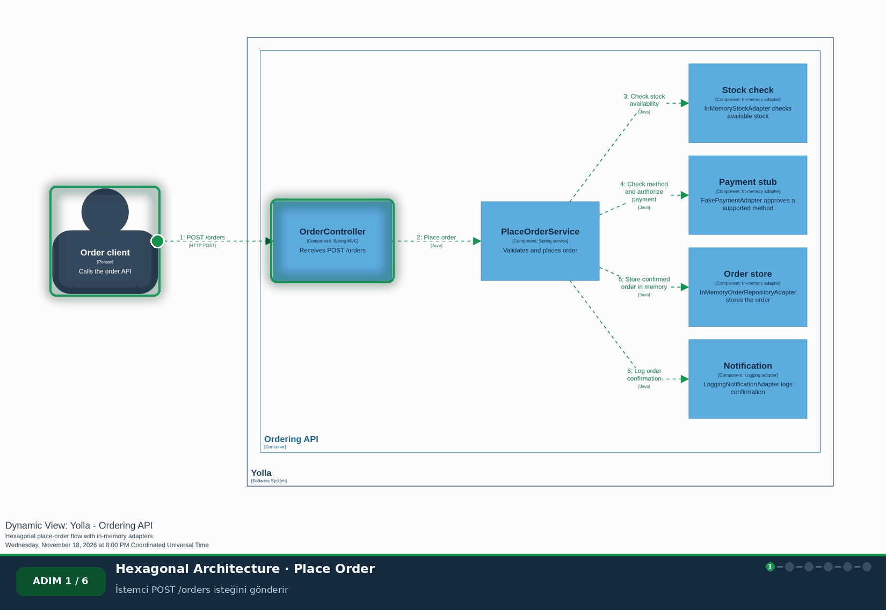

# Getting Started

## Database idempotency flow

The numbered view shows outbox delivery and how the payment consumer records processed aggregate IDs in MySQL before inserting a payment.

[Structurizr DSL source](docs/c4/workspace.dsl)

### Reference Documentation

For further reference, please consider the following sections:

* [Official Gradle documentation](https://docs.gradle.org)
* [Spring Boot Gradle Plugin Reference Guide](https://docs.spring.io/spring-boot/docs/3.2.2/gradle-plugin/reference/html/)
* [Create an OCI image](https://docs.spring.io/spring-boot/docs/3.2.2/gradle-plugin/reference/html/#build-image)

### Additional Links

These additional references should also help you:

* [Gradle Build Scans – insights for your project's build](https://scans.gradle.com#gradle)

